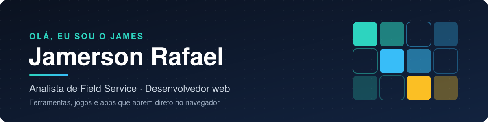

  

Resolvo problemas de TI no dia a dia e transformo os que se repetem em ferramentas web simples, que funcionam no celular e até sem internet.

Trabalho com suporte técnico na TI do Tribunal de Justiça de Roraima. Foi no campo, resolvendo os mesmos problemas várias vezes, que comecei a programar: primeiro em Java, hoje principalmente para a web.

  <a href="https://rafajames.github.io/meu-portifolio/"><b>Portfólio</b></a> ·
  <a href="https://www.linkedin.com/in/jamerson-rafael-a7a480249/"><b>LinkedIn</b></a>

## Projetos em destaque

Todos abrem direto no navegador. Clique em **Abrir** para testar.

<table>
  <tr>
    <td width="50%" valign="top">
      <h3>🗺️ MapTec · TJRR</h3>
      Encontra salas, setores e unidades nos prédios do tribunal. Feito para técnicos de campo, com busca e consulta offline.  
      <code>HTML</code> <code>JavaScript</code> <code>PWA</code>  
      <a href="https://rafajames.github.io/MapTec-TJRR/"><b>Abrir</b></a> · <a href="https://github.com/Rafajames/MapTec-TJRR">Código</a>
    </td>
    <td width="50%" valign="top">
      <h3>🌿 Potira</h3>
      Plataforma para profissionais de saúde: registro clínico, relatórios por período e portal do paciente, com IA opcional.  
      <code>JavaScript</code> <code>Supabase</code>  
      <a href="https://rafajames.github.io/florescer-relatorios/"><b>Abrir</b></a> · <a href="https://github.com/Rafajames/florescer-relatorios">Código</a>
    </td>
  </tr>
  <tr>
    <td valign="top">
      <h3>💰 Minha Carteira</h3>
      Finanças domésticas para casais e famílias, com dados compartilhados em tempo real e lançamento por texto ou voz.  
      <code>JavaScript</code> <code>Firebase</code> <code>PWA</code>  
      <a href="https://rafajames.github.io/Minha-carteira/"><b>Abrir</b></a> · <a href="https://github.com/Rafajames/Minha-carteira">Código</a>
    </td>
    <td valign="top">
      <h3>🧩 Shape Puzzle</h3>
      Quebra-cabeça lógico para navegador e Android, com música gerada por código, ranking, campeonatos e 13 idiomas.  
      <code>JavaScript</code> <code>Firebase</code> <code>Capacitor</code>  
      <a href="https://rafajames.github.io/ShapePuzzle/"><b>Jogar</b></a> · <a href="https://github.com/Rafajames/ShapePuzzle">Código</a>
    </td>
  </tr>
  <tr>
    <td valign="top">
      <h3>🚀 Navinha Espacial</h3>
      Jogo de nave com 8 naves, 12 inimigos e 5 chefes. Nasceu em Java e ganhou uma versão web para celular e PC.  
      <code>JavaScript</code> <code>Java</code>  
      <a href="https://rafajames.github.io/Navinha/"><b>Jogar</b></a> · <a href="https://github.com/Rafajames/Navinha">Código</a>
    </td>
    <td valign="top">
      <h3>🎵 Meusom</h3>
      Transforma uma música ou cantarola em versão calma e instrumental para sono e foco. O áudio não sai do computador.  
      <code>JavaScript</code> <code>Web Audio</code>  
      <a href="https://rafajames.github.io/meusom/"><b>Abrir</b></a> · <a href="https://github.com/Rafajames/meusom">Código</a>
    </td>
  </tr>
</table>

## Também por aqui

- **[Seu Assistente](https://github.com/Rafajames/seu-assistente)**: tarefas e diário para Android e web, com lembretes por voz. [Abrir](https://rafajames.github.io/seu-assistente/)
- **[Passe & Bate](https://github.com/Rafajames/Domino-passe-bate)**: dominó com regras regionais configuráveis e modo solo contra bots. [Jogar](https://rafajames.github.io/Domino-passe-bate/)
- **[Diário da Cefaleia](https://github.com/Rafajames/Diario-cefaleia-)**: acompanhamento de dores de cabeça para pacientes e profissionais, em pré-produção.

## Como eu trabalho

- **Simples para quem usa.** Faço sistemas para quem não é da área técnica. Se precisa de manual, ainda não está pronto.
- **Funciona em qualquer lugar.** Celular, computador, com ou sem internet.
- **Nasce de um problema real.** Cada projeto começa numa dor do trabalho e melhora com o retorno de quem usa.

## Tecnologias

**Front-end:** `HTML` `CSS` `JavaScript` `TypeScript` `PWA`
**Back-end e dados:** `Java` `Python` `Firebase` `Supabase` `SQLite`
**Ferramentas:** `Git` `GitHub Actions` `GitHub Pages` `Android`
